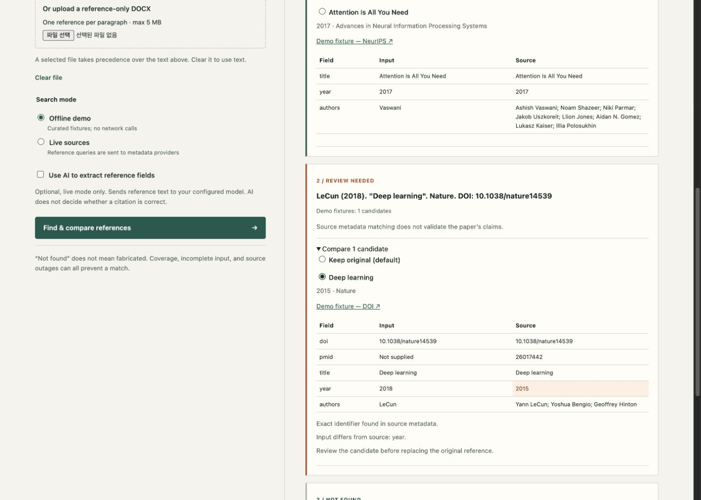

# Reference Verifier

Find source-backed bibliographic candidates, inspect disagreements, and export only the corrections you choose.

Reference Verifier is a local research-writing assistant built around **retrieval and explicit evidence**. It searches Crossref, OpenAlex, and PubMed, compares titles, authors, years, DOIs and PMIDs, and keeps source links alongside each candidate. An optional language model extracts fields from messy references; it does not generate the replacement metadata or decide what is true.

## Try it

Python 3.10 or newer:

```bash
python -m venv .venv
source .venv/bin/activate
pip install -e '.[test]'
reference-verifier serve
```

Open <http://127.0.0.1:8765>. Click **Load example**, then check references in **Offline demo** mode. No keys or network calls are needed for the demo. The three examples show a matching reference, a wrong publication year, and an unmatched fictional title.

Switch to live mode to query the three metadata services. Input a reference per line, or upload a reference-only DOCX with one reference per paragraph. Each candidate has field comparisons and source links. **Keep original** is selected by default; choose candidates explicitly before exporting TXT or DOCX. Download the JSON report to retain the full evidence and source failures.



## CLI

```bash
reference-verifier check examples/references.txt --demo --output report.json
reference-verifier export report.json --selections examples/selections.json --output reviewed.docx
# Live retrieval, with deterministic extraction:
reference-verifier check examples/references.txt --output live-report.json
pytest -q
```

Selections map a zero-based reference index to the candidate ID shown in its report. Omitted references remain unchanged. Never reuse a selections file with a different report without reviewing it.

## What the AI does

Set `REFERENCE_LLM_API_KEY` and `REFERENCE_LLM_MODEL`, then enable AI extraction in the UI or add `--ai` to `check`. `REFERENCE_LLM_URL` optionally overrides the OpenAI-compatible Chat Completions endpoint. See `.env.example`; environment files are **not** automatically loaded.

The model receives the reference text and returns extracted title/author/year fields. The implementation accepts only fields that occur in the input, and obtains identifiers through deterministic parsing. Retrieval supplies replacement metadata. If extraction fails or configuration is absent, rules remain available and the report shows a warning. Span checks reduce invented metadata but do not prove the semantic correctness of extraction.

Live mode sends reference queries to metadata providers. Enabling AI additionally sends the reference text to the configured model service and may incur usage charges. The server binds to loopback only, keeps at most 32 reports in memory for one hour, and writes files only through explicit CLI output or browser downloads. It is not a hosted multi-user service.

## Interpretation and limits

- **Metadata match:** strong agreement under conservative rules, not validation of a paper's scientific claims.
- **Review needed:** conflicting/missing evidence, ambiguity, or a provider outage. Differences in author initials or publication dates can trigger review.
- **Not found:** no candidate returned by the completed searches; not proof that a reference is fabricated.
- **Search incomplete:** sources failed and no candidate was returned.

Ranking scores are heuristics, not calibrated confidence probabilities. Providers may share upstream metadata; three agreeing sources are not three independent confirmations. Source disagreements are retained. The tool does not read full papers, verify claim-to-citation support, guarantee zero hallucinations, or provide comprehensive recall. Rule-based parsing favors `Author (year). "Title".` and identifiers; arbitrary citation styles may need the optional extractor or manual review. DOCX exports are new reference-only documents, not in-place edits preserving manuscript layout. Tables, footnotes and embedded citations are outside this MVP.

## Architecture

`reference_verifier/` contains extraction, three provider adapters, conservative record merging/comparison, explicit-selection export, CLI, and a FastAPI review UI. `tests_v2/` exercises wrong-year/author/title/identifier cases, ambiguity, source disagreement, outages, unsupported AI output, exports and HTTP boundaries. Offline fixtures make CI repeatable; live results depend on provider availability.

See [validation](docs/validation.md) for what was actually checked and [project history](docs/provenance.md) for the earlier implementation. The original `infolumi/` code and tests are retained for provenance but are not installed or run by the new package configuration.

## Provider documentation

- [Crossref REST API](https://www.crossref.org/documentation/retrieve-metadata/rest-api/)
- [OpenAlex API authentication](https://help.openalex.org/api/authentication/)
- [NCBI E-utilities](https://www.ncbi.nlm.nih.gov/books/NBK25501/)
- [OpenAI Chat API](https://developers.openai.com/api/reference/resources/chat)

Optional provider configuration: `CROSSREF_MAILTO`, `OPENALEX_API_KEY`, `NCBI_API_KEY`. Public access and rate limits are controlled by each provider.
